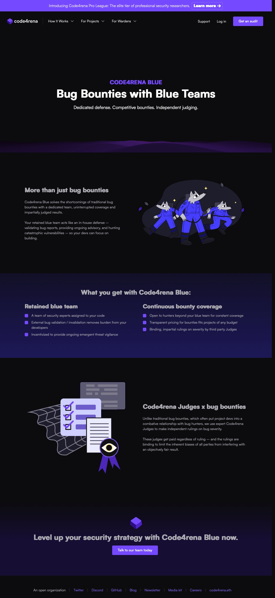
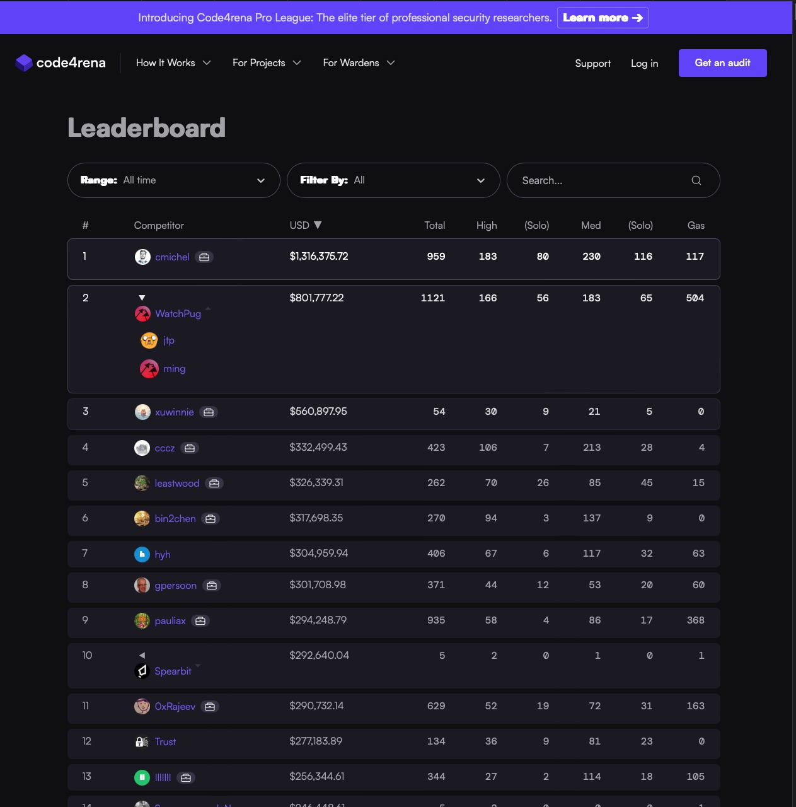
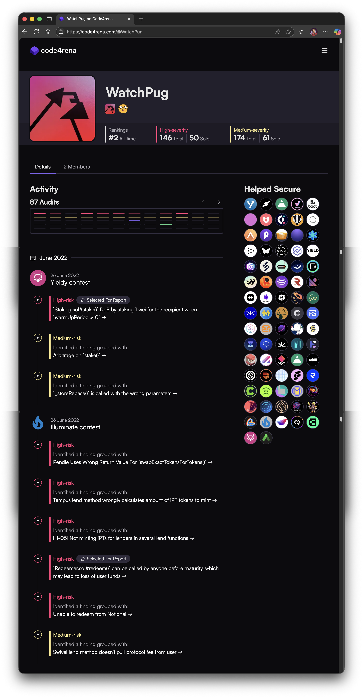
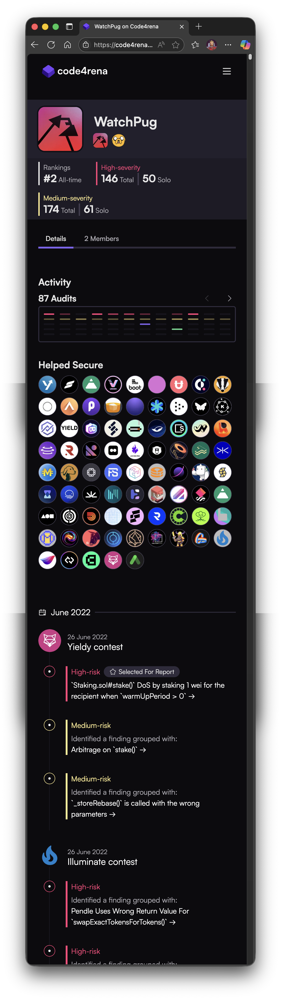

## Code4rena Platform

Code4rena (C4) is a competitive audit and bounty platform where security researchers (referred to as Wardens) review, audit, and analyze codebases for security vulnerabilities in exchange for bounties provided by sponsoring projects.

As a member of the [Stack Five](https://stackfive.io) team, I was embedded in Code4rena's engineering team working primarily on front-end pages and components, but also backend functionality, on their web platform <https://code4rena.com/>. 

In addition to the web front end there was also a bespoke NPM module for commonly reused components and functions, and an admin tool for judges to review submitted audits by wardens.

This project also included one of my favorite experiences as a developer: for approximately two months I was given free rein on the backlog of submitted issues, bugs, and updates, and was able to reduce the list from well over one hundred tasks to under twenty. These tasks ranged from simple bug fixes to complex CSS and logic problems.

### Tech Stack

Next.js, TypeScript, SCSS/Sass, Node.js, PostgreSQL, Vercel, NPM, GitHub, GitHub Issues

### Challenges

The primary challenges for this project were the distributed team, which was worldwide. We solved this with communication via slack and email. One of my team members was located on the other side of the planet, meaning we could hand work off to one another and create an almost constant cadence.

The other was integrating all of the client's projects, and maintaining two separate UIs, one for logged-in users and one for everyone else, which we did by implementing modern SCSS.

### Screenshots

#### Code4rena Homepage

The Code4rena homepage, featuring several reusable components.

#### Leaderboard

The site's leaderboard loaded warden information with several filters, and also allows for warden teams to be viewed as one unit.

#### Code4rena Warden Profile (Desktop)

The warden profile is fully responsive and features several reusable components created entirely in HTML and SCSS.

#### Code4rena Warden Profile (Mobile)

The responsive mobile view of the same.

