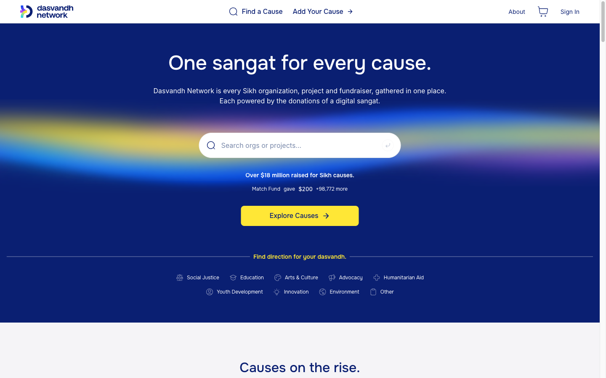
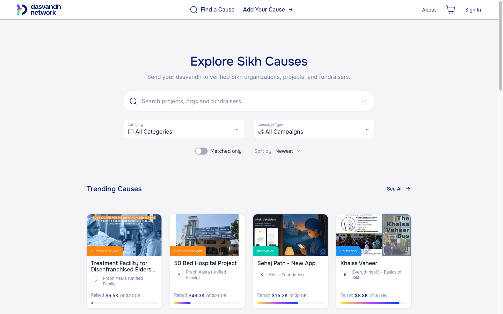
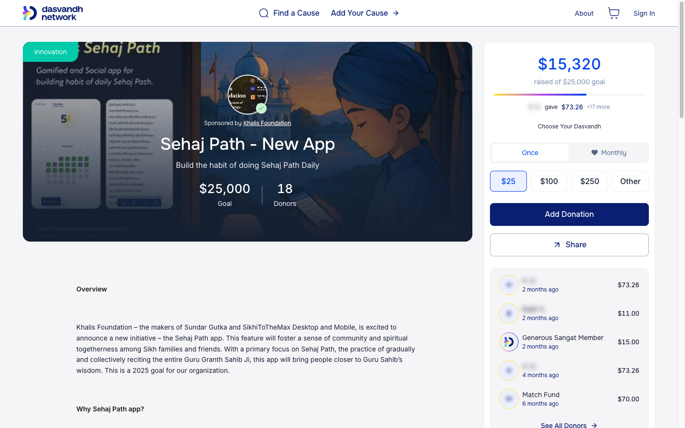
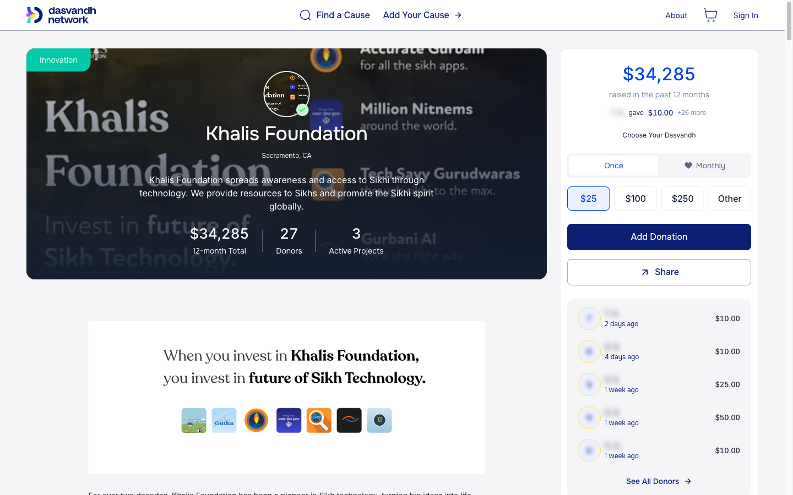
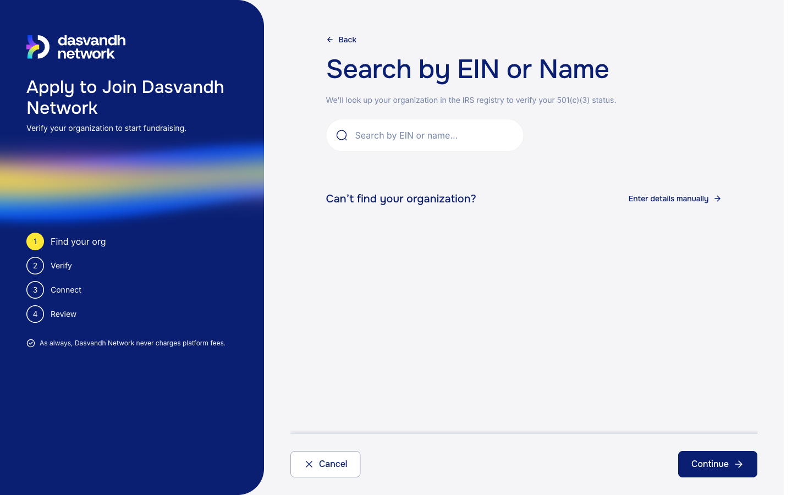
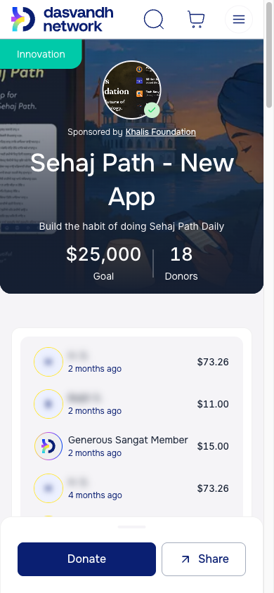

## Dasvandh Network

[Dasvandh Network](https://dvn.org) (DVN) is an online Sikh giving platform that connects donors with verified Sikh organizations, projects, and fundraisers. _Dasvandh_ is the Sikh practice of giving a tenth of what you earn, and DVN has helped the community raise more than $18 million for Sikh causes.

The existing platform had been built up over many years as a server-rendered ASP.NET application with Razor views and jQuery. It supported complex fundraising workflows, but the donor experience was slow and friction-heavy, it worked poorly on mobile, and partner organizations lacked modern tools. DVN contracted [Skyrocket Digital](https://skyrocketdigital.com) to rebuild the platform as DVN3: a new, mobile-first front end on top of the existing back end, exposed through a new API layer.

I was the lead front end developer on the rebuild and wrote the large majority of the new web application. I built the public site, the donation and checkout flow, the donor account area, the organization and fundraiser dashboards, and the shared component library that all of it is built from.

### Tech Stack

Next.js (App Router), React 19, TypeScript, Tailwind CSS, React Aria Components, Untitled UI Icons, Stripe (Payment Element and deferred intents), Google Tag Manager / GA4, Webflow, Botpress, Sentry, Marker.io, Vitest, Testing Library, Playwright, Docker, Azure, and more.

### Features

- **Discovery:** a home page and Explore page for finding causes by search, category, and campaign type, with trending causes, featured campaigns, and organizations.
- **Cause pages:** organization, project, fundraiser, and event pages with live progress, recent donors, updates, and sharing.
- **Cart & checkout:** donors can add several causes to a cart, give once or monthly, and check out in a single step using Stripe's Payment Element, including saved payment methods and corporate gift matching.
- **Donor accounts:** donation history, tax receipts, recurring gift management, saved payment methods, profile and security settings, and magic link sign-in.
- **Fundraisers:** a step-by-step wizard for anyone to start a fundraiser for a cause, and a dashboard to manage it and post updates.
- **Organizations:** an application flow that verifies a charity against the IRS registry, plus an organization dashboard for managing its profile, projects, and updates.
- **Marketing content:** Webflow-managed marketing pages rendered in place within the app and included in the sitemap.
- **Analytics:** a typed event layer for Google Tag Manager covering discovery, cart, checkout, payment, sign-up, and fundraiser creation.

### Challenges

The new front end had to be built against a mature back end with a very broad domain, so much of the work was mapping years of existing fundraising behaviour (recurring gifts, matching funds, receipts, organization verification) into new, simpler flows without losing any of it.

The design was also strict. Every screen is drawn in a large Figma file organized as atoms, molecules, organisms, templates, and screens, and the component library mirrors that structure directly. I built the library tier by tier and audited it against the designs as they evolved, so each screen is composed from shared, drawn components rather than one-off markup.

Finally, checkout carries real money. The cart, Stripe payment flow, and their analytics events were built and tested carefully so that every outcome (success, failure, and cancellation) is handled and reported correctly.

### Screenshots

#### Home

The home page introduces the network, with search, cause categories, and live totals.

#### Explore

Donors can search and filter every organization, project, and fundraiser on the platform.

#### Project

Each project page shows its story and progress, alongside a donation panel for giving once or monthly, sharing, and recent donors. _Donor names are blurred in these screenshots._

#### Organization

Organization pages summarize a charity's giving over the past year, its donors, and its active projects.

#### Organization Application

Charities apply to join the network through a guided flow that starts by looking them up in the IRS registry to verify their 501(c)(3) status.

#### Mobile

The site is built mobile-first. On small screens the donation panel collapses into a docked bar with donate and share actions.

