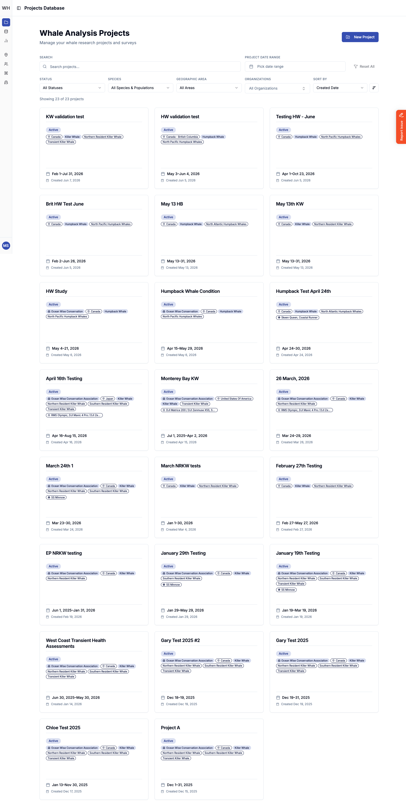
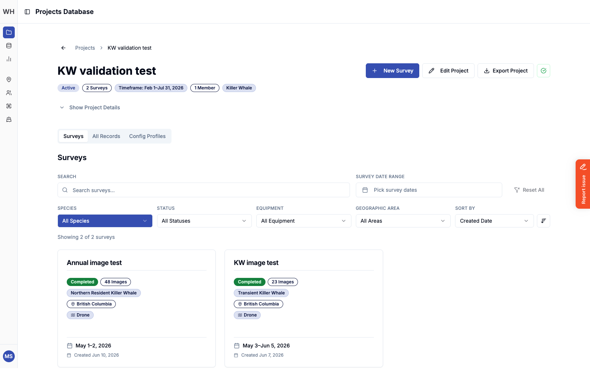
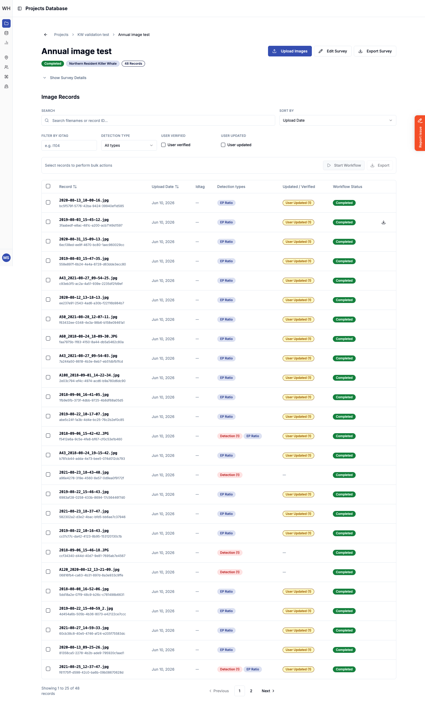
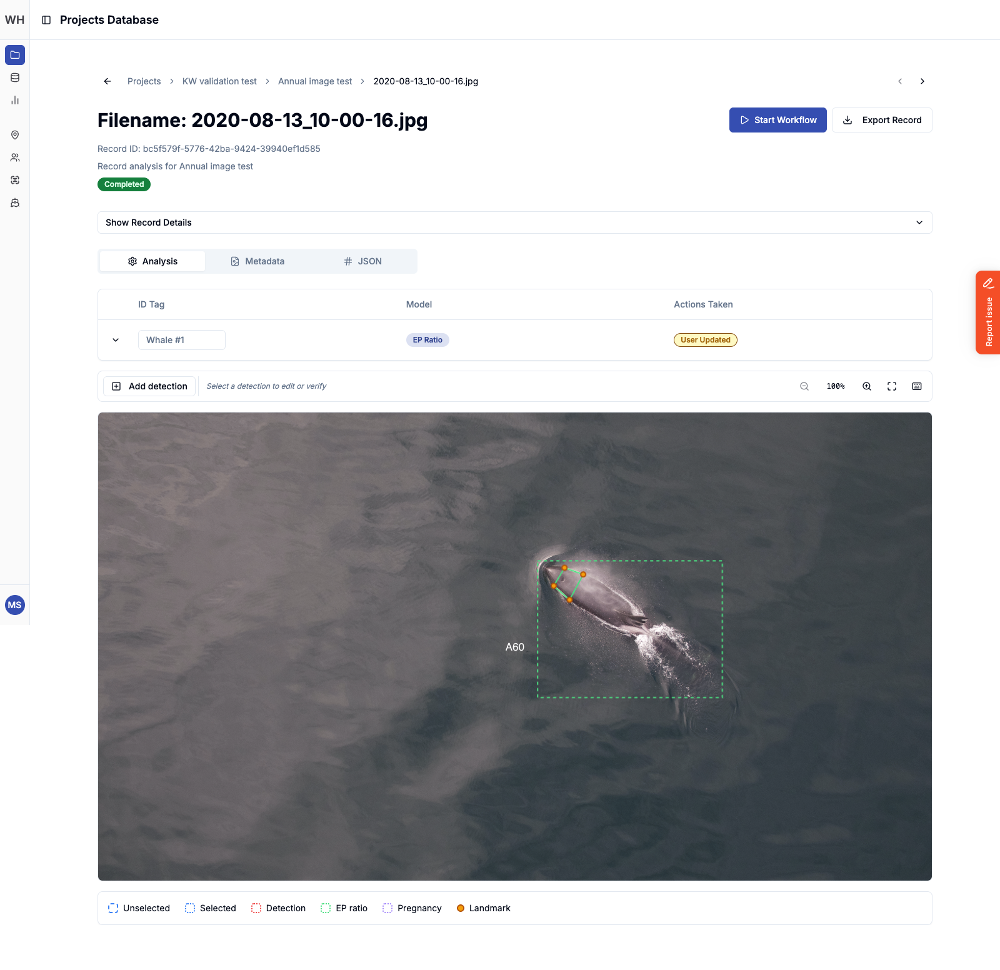
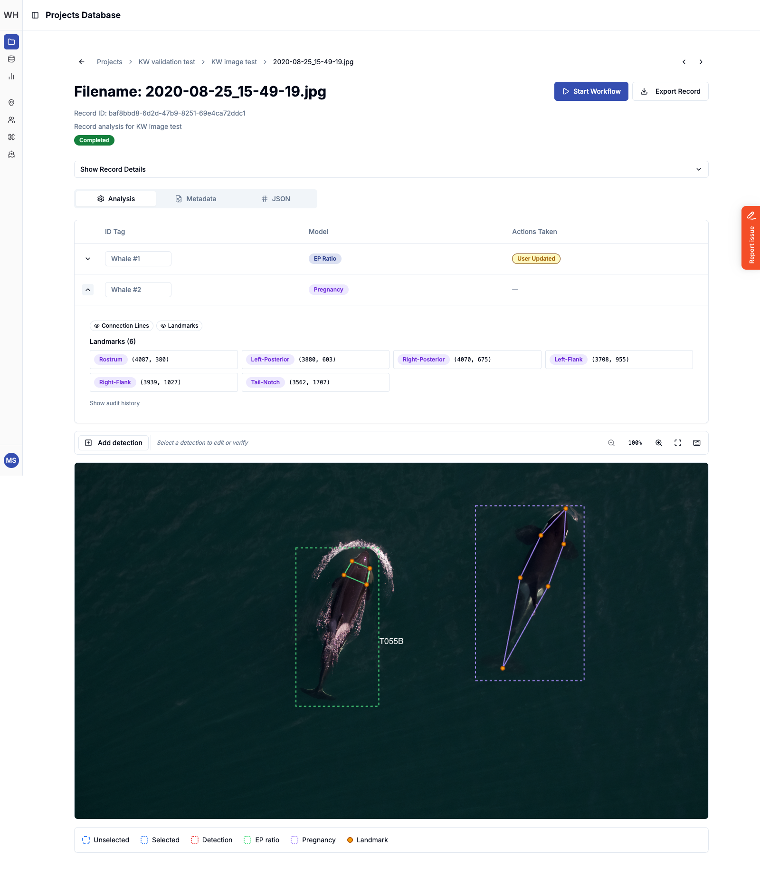
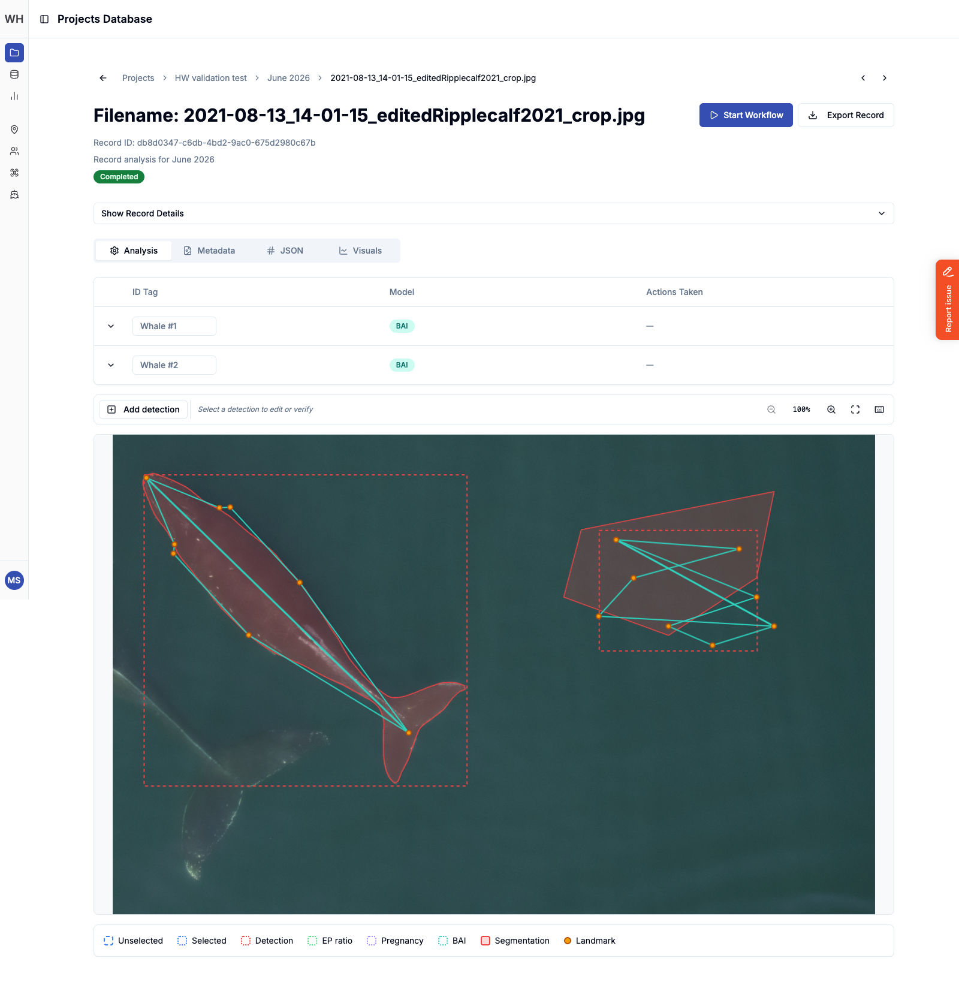
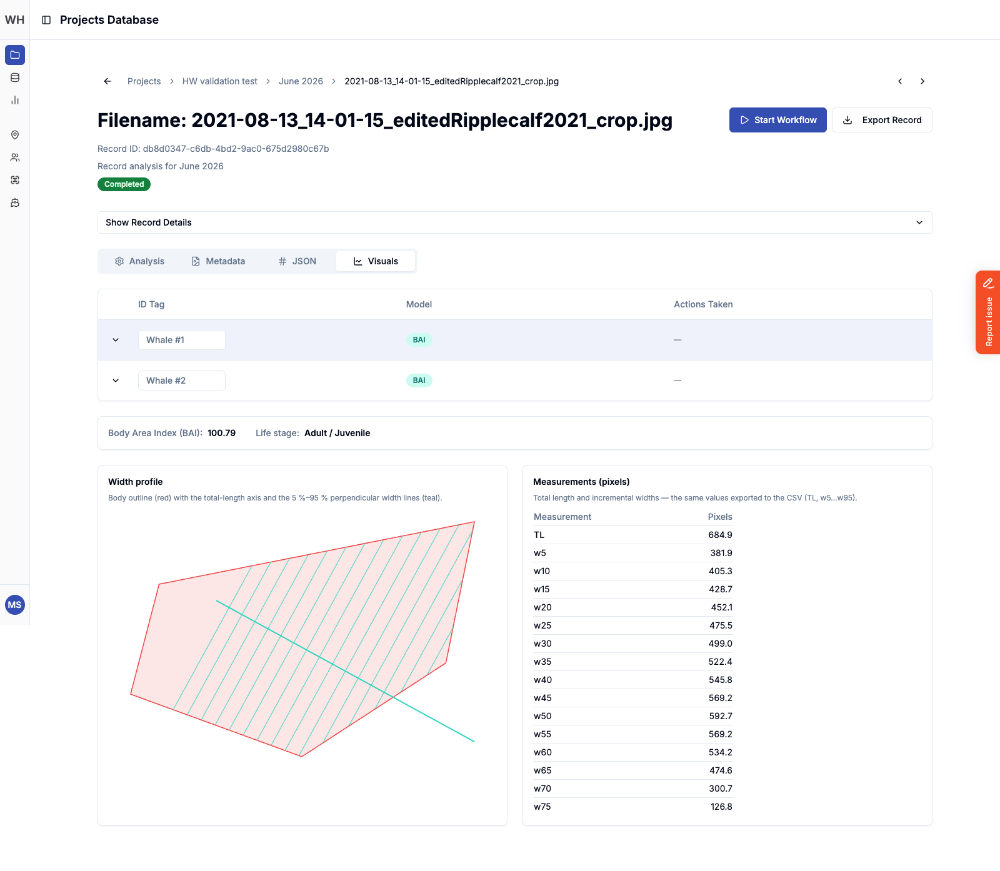

## Ocean Wise: Whale Health

Ocean Wise is a major conservation non-profit that has multiple programs in place to help protect the world's oceans and the life that lives within them. Part of that work is monitoring the health of whale populations off the coast of British Columbia. Researchers fly drones over killer whales and humpback whales, and measure the animals in the resulting aerial photographs to track body condition, growth, and pregnancy over time. Done by hand, that measurement work is slow and difficult to keep consistent across a large set of images.

Ocean Wise contracted [Skyrocket Digital](https://skyrocketdigital.com) to build the Whale Health platform, a tool that uses computer vision models to detect whales in drone images, place anatomical landmarks on each animal, and calculate health metrics from them. Researchers then review, correct, and verify those results before exporting them for statistical analysis.

I was the sole front end developer on the project and built the web application myself, working alongside the back end team who built the API, job queue, and model integration. Researchers use it to organize their work into projects and surveys, upload drone imagery with accompanying metadata, run the analysis workflow, and review every detection on an interactive canvas.

### Tech Stack

Next.js 16 (App Router), React 19, TypeScript, Turbopack, Tailwind CSS, Radix UI, Redux Toolkit, RTK Query, Fabric.js, Recharts, React Hook Form, Zod, Auth0, Sentry, Marker.io, Jest, Docker, Azure App Service, and more.

### Features

- **Projects & surveys:** projects group surveys by species, population, region, organization, and date range, with filtering, sorting, and archiving at both levels.
- **Image upload with metadata:** bulk drone image uploads with an optional CSV of flight, encounter, and image data. Every row is validated before upload, and every error is listed with the affected images highlighted.
- **Analysis workflow:** researchers queue records for analysis against a configured set of models and the interface polls the running jobs, updating records as their results arrive.
- **Detection canvas:** a zoomable, keyboard-driven canvas built on [Fabric.js](https://fabricjs.com/) that draws each detection's bounding box, landmarks, connection lines, and body outline over the source image. Researchers can drag landmarks to correct them, add or remove detections by hand, tag individual whales, and verify results, with a full audit history of every change.
- **Species-specific analysis:**
  - **EP Ratio:** killer whale eye-patch measurements from four head landmarks.
  - **Pregnancy:** six killer whale body landmarks, with a pregnancy classification badge, a wireframe diagram, and a cluster plot.
  - **Body Area Index (BAI):** humpback whale body condition from eight landmarks and a segmented body outline, with a width profile chart and a table of total length and incremental widths.
- **Exports:** per-record, per-survey, and per-project CSV exports formatted for analysis in R.
- **Reference data:** management screens for geographic areas, team members, equipment, vessels, organizations, and an equipment catalog, with admin-only areas gated by role.

### Challenges

The heart of the application is the detection canvas. It needed to render very high resolution drone imagery while keeping landmarks precise to the pixel, stay sharp and responsive when zoomed in for fine adjustments, and keep the canvas, the detections table, and the per-whale visuals in sync as a researcher moves between them. Each species and analysis type has its own set of landmarks and rules about what can be edited, so the canvas is driven by configuration rather than hard-coded for a single model.

The other challenge was the pace of the domain itself. The research team's methods evolved during development, adding new analysis types, new filters, and stricter validation, and I worked closely with the researchers and the back end team to ship those changes quickly without disrupting surveys already in progress.

### Screenshots

#### Projects

The projects screen lists all whale analysis projects, filterable by status, species and population, geographic area, organization, and date range.

#### Project Surveys

Each project contains surveys. The project header summarizes its status, timeframe, members, and species, and the tabs switch between surveys, every record in the project, and the project's model configuration.

#### Survey Records

The survey screen lists every image record with its detection types, verification state, and workflow status. Records can be filtered, searched, and selected in bulk to start the analysis workflow or export results.

#### Detection Canvas: EP Ratio

The record screen pairs a table of detections with the canvas. Here a killer whale has been detected and its four eye-patch landmarks placed, and the record has been updated by a researcher.

#### Detection Canvas: Pregnancy

Killer whale pregnancy analysis places six body landmarks. Expanding a detection lists each landmark's coordinates, with toggles for the overlay and access to the audit history.

#### Detection Canvas: Body Area Index

Humpback whales are analyzed using a segmented body outline in addition to landmarks, shown here with two animals detected in the same image.

#### Body Area Index Visuals

The Visuals tab shows the calculated Body Area Index and life stage, a width profile chart drawn from the body outline, and the same total length and width measurements that are exported to CSV.

