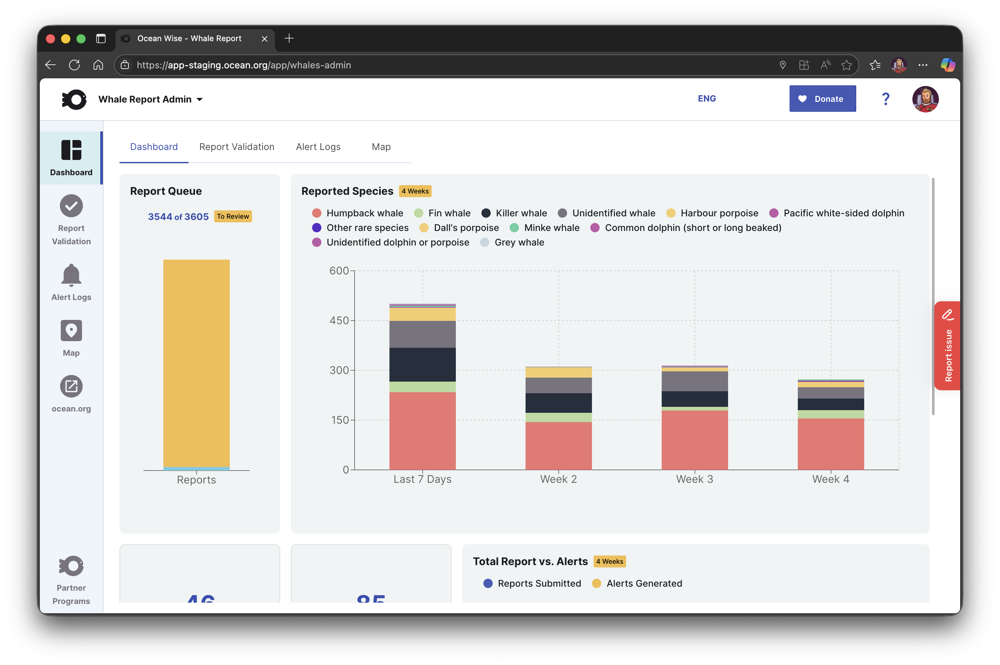
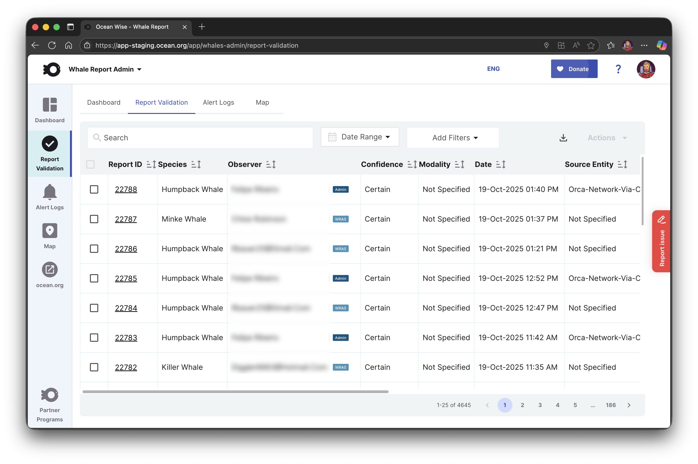
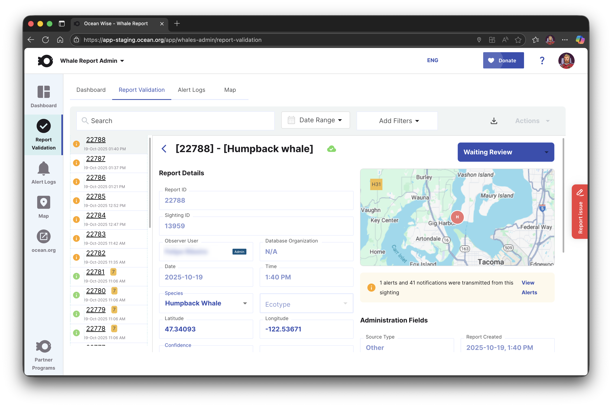
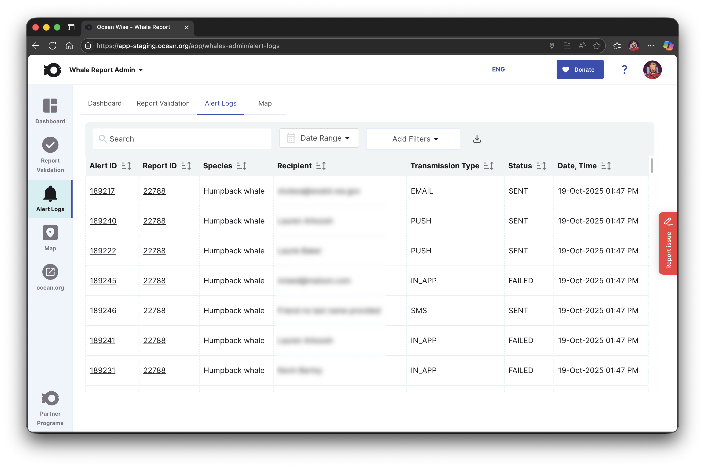
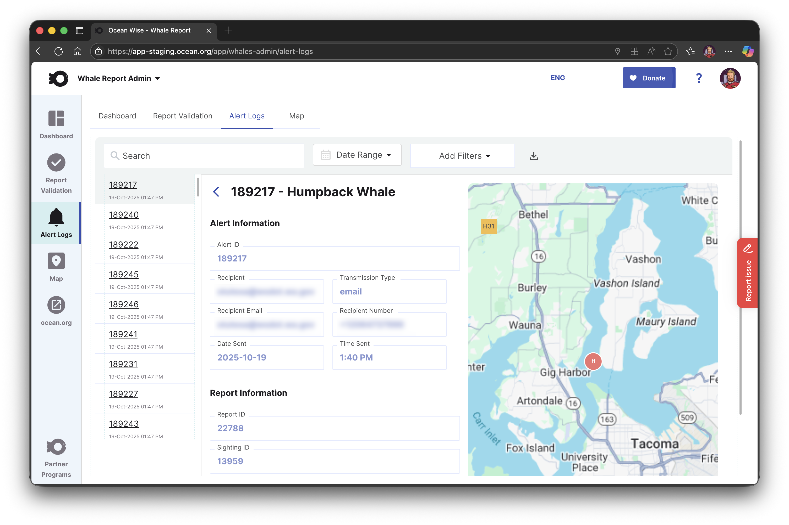
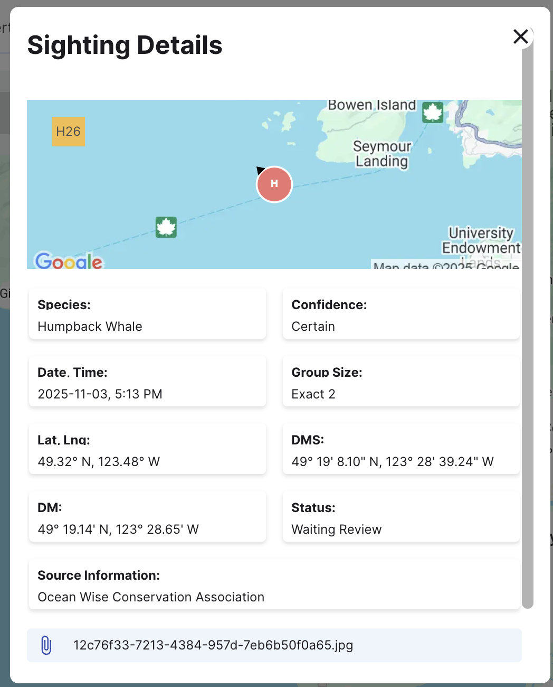

## Ocean Wise: Whale Report Administration

Ocean Wise is a major conservation non-profit that has multiple programs in place to help protect the world's oceans and the life that lives within them. The Whale Report Alert System (WRAS) is a program designed to alert mariners to the presence of whales in shipping lanes with the end goal of reducing whale strikes, of which there are as many as 20,000 every year. The system accepts data from automated systems as well as from users on the water.

Ocean Wise contracted [Skyrocket Digital](https://skyrocketdigital.com) to build an administration panel for this program. Created as a module of their broader web platform (<https://app.ocean.org>). As the primary contributor I built the screens and interactions for this module which allow administrator users to interact with and make changes to submitted whale sightings. Administrators are able to change many of the sighting details, including their status. This allows them to verify sightings, and remove sightings from public view that may not meet the criteria to be a valid sighting.

The admin panel interacts with the same back end that powers the Whale Report Alert System itself to allow these changes.

### Tech Stack

Next.js 15, TypeScript, Turbopack, SCSS/Sass (modules), Auth0, IronSession, Tanstack Table, Recharts, Redux Toolkit, RTK Query, Axios, Google Maps, Google Tag Manager, i18n (English & French), MySQL, Contentful, SalesForce, Azure, Jest, PlayWright, Sentry, Marker.io, notistack, and more.

### Challenges & Post Launch

The primary challenge for this admin panel is the specificity. This application has few users, but those users require a high level of detail as well as a fine level of control over what they are doing. The smallest of changes has a large impact, and I worked closely with the stakeholders to make sure that their feedback was heard and applied quickly and carefully.

### Screenshots

#### Dashboard

The dashboard offers an at-a-glance look at the system, with charts created using <a href="https://recharts.github.io/" target="_blank">Recharts</a>.

#### Report Validation Table

This is the main screen of the application, where admins view, edit (if necessary), and validate Whale Sightings. The table view is built with <a href="https://tanstack.com/table/latest" target="_blank">TanStack Table</a>

#### Validation Details

The details screen is built from scratch and allows for fine control over several data points in a whale sighting, including the longitude & latitude (with live updates on the map), the species and ecotype (subspecies) if applicable. The table also persists, compressing to the left side with the selected report highlighted.

#### Alert Logs

The alert log (since renamed notification log) is a log of notifications sent to mariners from specific sightings. Once again using TanStack table and many of the same styling cues.

#### Alert Details

The alert details screen is built from scratch and informational only.

#### Map View

The map view reuses the map component originally created for the [Whale Report Alert System](../Ocean-Wise-Whale-Report/), displaying similar data but with interactions sending users back to relevant admin panel screens.

#### Sighting Detail

Also reused from the Whale Report Alert System, but shows slightly different information and any attached images.

