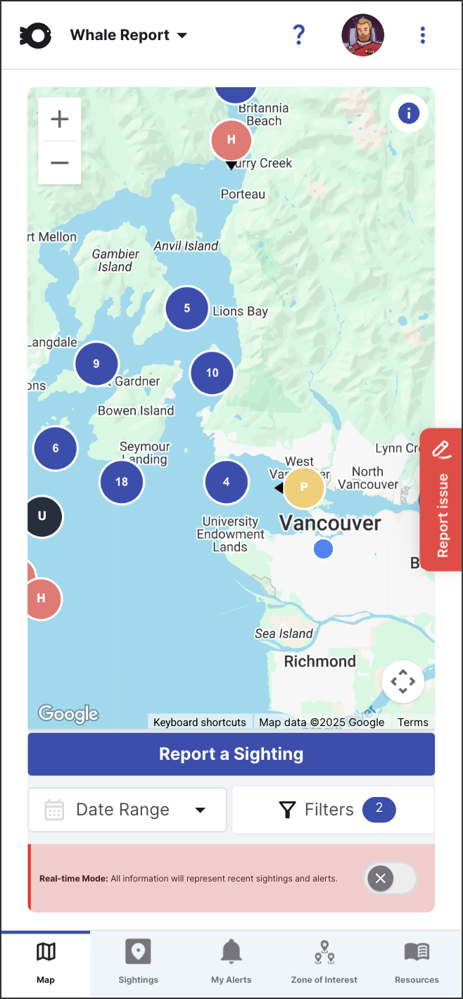
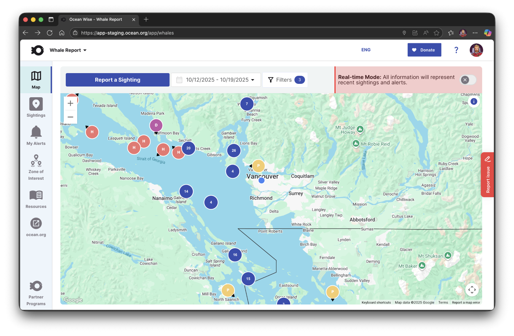
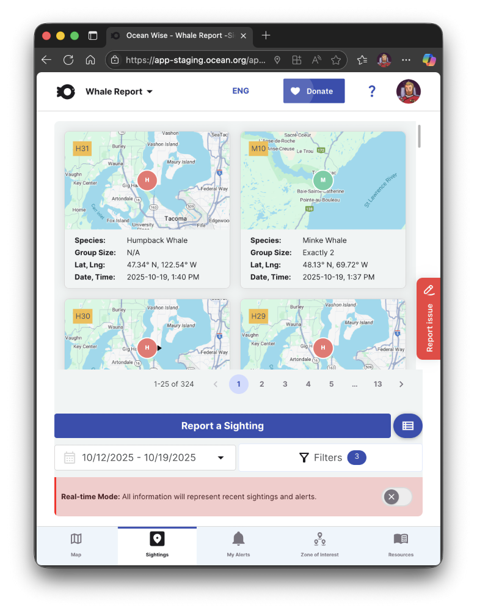
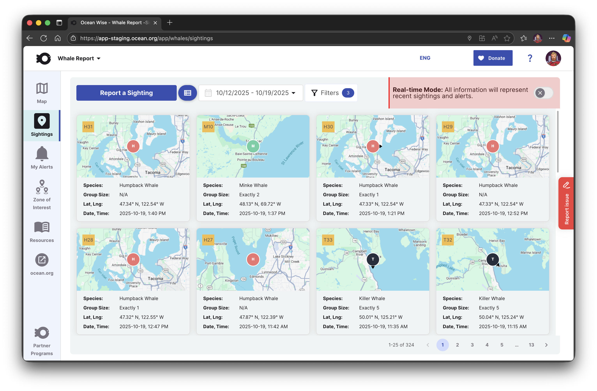
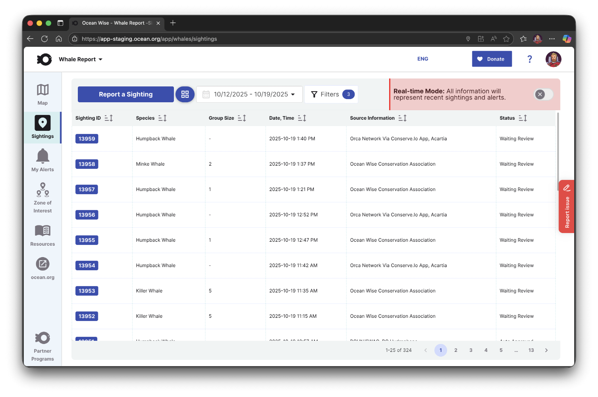
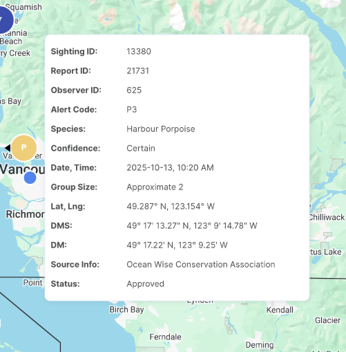
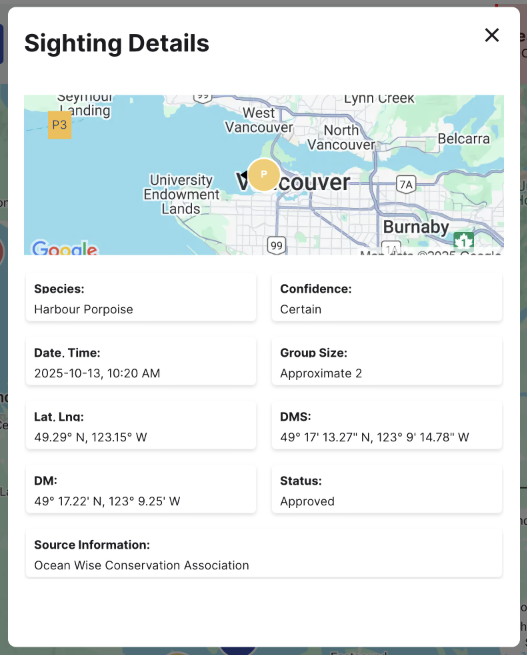
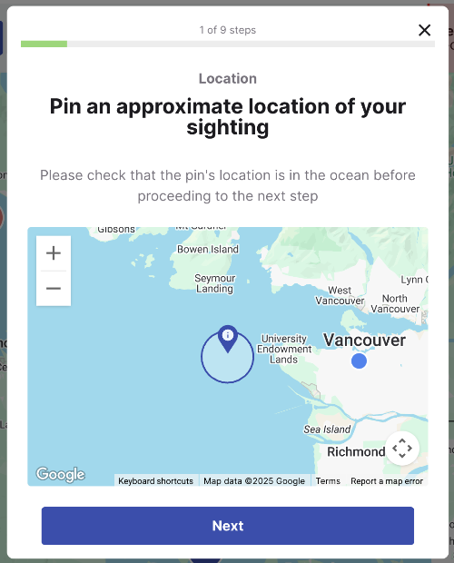

## Ocean Wise Whale Report Alert System

Ocean Wise is a major conservation non-profit that has multiple programs in place to help protect the worlds oceans and the life that lives within them. The Whale Report Alert System (WRAS) is a program designed to alert mariners to the presence of whales in shipping lanes with the end goal of reducing whale strikes, of which there are as many as 20,000 every year. The sytem accepts data from automated systems as well as from users on the water.

Ocean Wise contracted Skyrocket Digital to upgrade their legacy system to a new, modern, multiplatform system and in 2024 I became the primary contributor on for the web front end, which is integrated into app.ocean.org (<https://app.ocean.org>), the web platform we also modernized for them.

The system displays whale sighting data from several sources as well as accepts whale sightings from both everyday users and mariners. Users get different UI options depending on what user type they are, the former receiving time-delayed updates and the latter receiving updates in real time.

The system is designed using a responsive, mobile-first approach. Through this program I also refactored core components of the web platform for increased readability, maintainability, and performance.

### Tech Stack

Next.js 15, TypeScript, Turbopack, SCSS/Sass (modules), Auth0, IronSession, Redux Toolkit, RTK Query, Axios, Google Maps, Google Tag Manager, i18n (English & French), Contentful, SalesForce, Azure, Jest, PlayWright, Sentry, Marker.io, notistack, Azure Notification Hub, and more.

### Screenshots

#### Map View (Mobile):

The main mobile view of the app, displaying whale sightings both individual and clustered. Users are authenticated using Auth0 and user data is drawn from the bespoke NestJS back end.

#### Map View (Desktop):

The main desktop view of the app, displaying whale sightings both individual and clusterd.

#### Map View with Marine Mammal Regulation Zones (Desktop)

The main view of the app, with [Marine Mammal Regulation](https://en.wikipedia.org/wiki/Marine_Mammal_Regulations) view enabled.

#### Sightings View (Tablet):

A display of indiviudal sightings with a detail map and information.

#### Sightings View (Desktop):

#### Sightings Table View

The table view of sightings.

#### Sighting Detail Overlay

An overlay triggered by mousing over a sighting marker on the map.

#### Sighting Detail Modal

A modal triggered by clicking on a map marker, sighting widget, or id (depending on the view). This modal is also used to display alert information.

#### Sighting Submission

A grid showing the sighting submission form across different devices and states.

    

        
    

