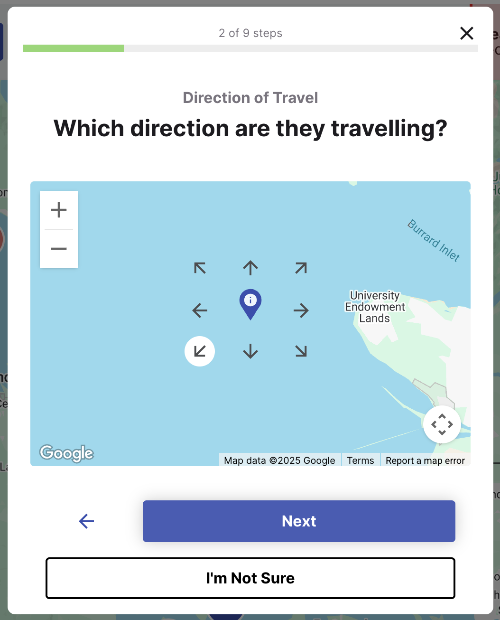
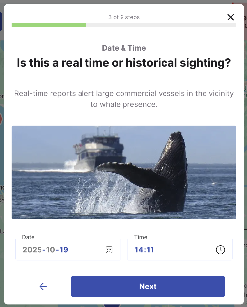
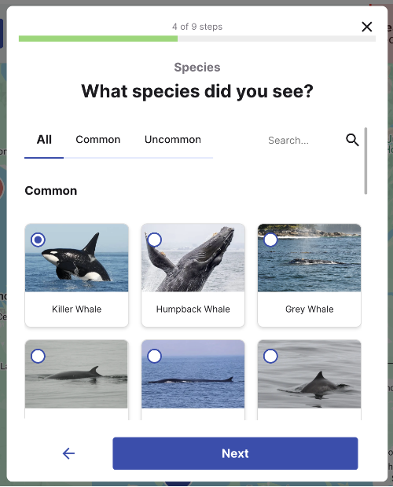
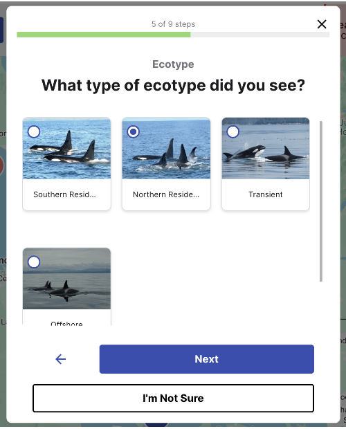
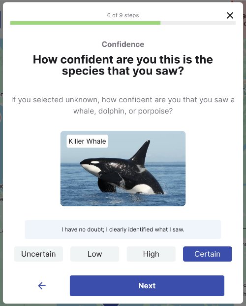
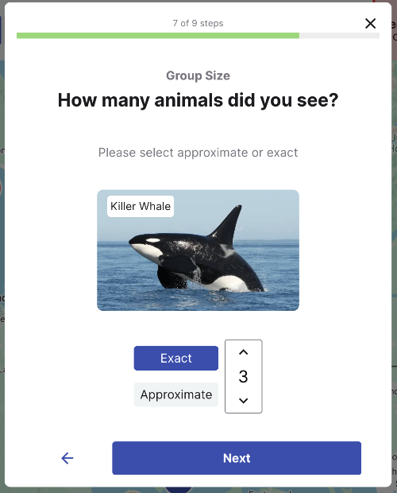
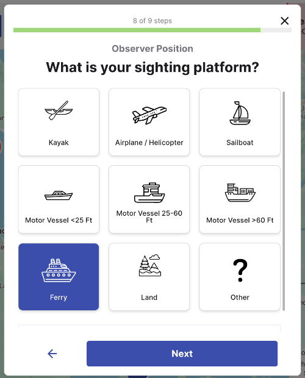
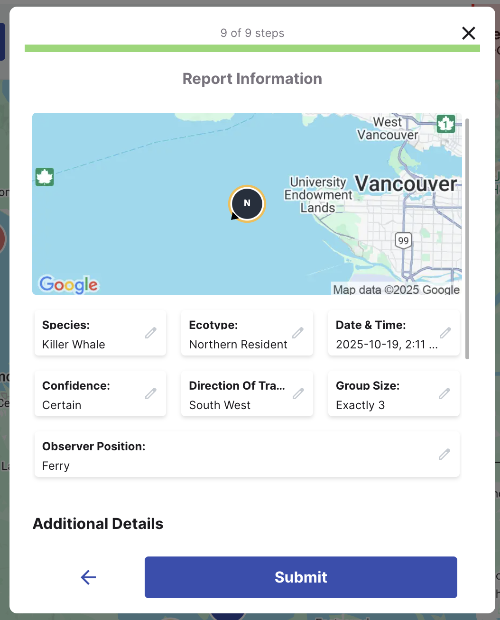

## Ocean Wise Whale Report Alert System

Ocean Wise is a major conservation non-profit that has multiple programs in place to help protect the world's oceans and the life that lives within them. The Whale Report Alert System (WRAS) is a program designed to alert mariners to the presence of whales in shipping lanes with the end goal of reducing whale strikes, of which there are as many as 20,000 every year. The system accepts data from automated systems as well as from users on the water.

Ocean Wise contracted [Skyrocket Digital](https://skyrocketdigital.com) to upgrade their legacy system to a new, modern, multiplatform system and in 2024 I became the primary contributor for the web front end, which is integrated into app.ocean.org (<https://app.ocean.org>), the web platform we also modernized for them.

The system displays whale sighting data from several sources as well as accepts whale sightings from both everyday users and mariners. Users get different UI options depending on what user type they are, the former receiving time-delayed updates and the latter receiving updates in real time.

The system is designed using a responsive, mobile-first approach. Through this program I also refactored core components of the web platform for increased readability, maintainability, and performance.

### Tech Stack

Next.js 15, TypeScript, Turbopack, SCSS/Sass (modules), Auth0, IronSession, Redux Toolkit, RTK Query, Axios, Google Maps, Google Tag Manager, i18n (English & French), MySQL, Contentful, SalesForce, Azure, Jest, PlayWright, Sentry, Marker.io, notistack, Azure Notification Hub, and more.

### Challenges

The single biggest challenge for this project was time. We faced both high expectations and a short timeline, just a few months to go from zero to working product.

We solved this by dividing and conquering the work, with myself taking on the bulk of the web front end work. We then delivered an MVP version and iterated on that until we launched in the summer of 2025.

### Statistics

The Whale Report Alert System now has over 800 users who have submitted an average of 30,000 reports per month in the first three months of availability.

### Post-Launch

We continue to iterate on the platform, adding aesthetic and performance refinements. These include accessibility updates across the site, improvements to the UI and performance of loading and filtering sightings and alerts, improving location precision, and improving reliability of push notifications and browser based notifications.

### Screenshots

#### Map View (Mobile):

The main mobile view of the app, displaying whale sightings both individual and clustered. Users are authenticated using Auth0 and user data is drawn from the bespoke NestJS back end.

#### Map View (Desktop):

The main desktop view of the app, displaying whale sightings both individual and clustered.

#### Map View with Marine Mammal Regulation Zones (Desktop)

The main view of the app, with [Marine Mammal Regulation](https://en.wikipedia.org/wiki/Marine_Mammal_Regulations) view enabled.

#### Sightings View (Tablet):

A display of individual sightings with a detail map and information.

#### Sightings View (Desktop):

#### Sightings Table View

The table view of sightings.

#### Sighting Details

Sighting details can be seen via both a map overlay (triggered by mousing over a map marker) and a details modal (triggered by clicking on a marker, widget, or ID depending on the view).

 

#### Sighting Submission Flow

This is the flow through which a user may report a whale sighting, either in real time or historically. The flow includes support for location and direction via Google Maps, ecotypes (if available) and other data, all of which is sent to the back end using RTK Query.

  

  

  
