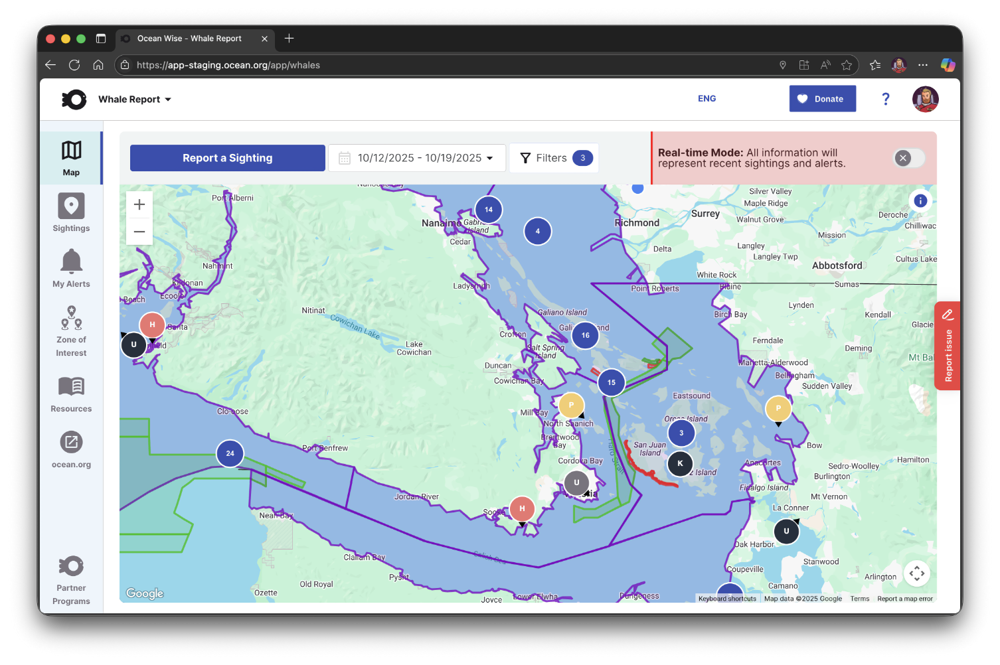
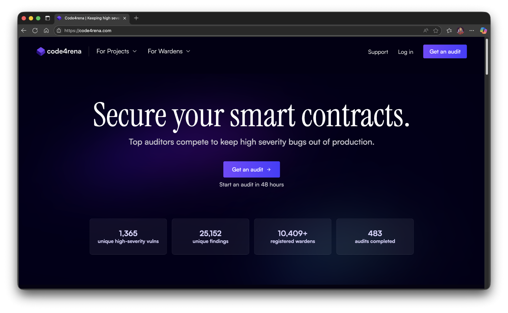

# Client-Work-Case-Studies

This is a repository with some information about client work I have performend, intended to be a companion to my portfolio.

## Projects

### [Ocean Wise: Whale Report Alert System](./Ocean-Wise-Whale-Report/)

A real time system which everyday users and mariners alike can use to report and be alerted to the presence of whales in shipping lanes with the end goal of reducing fatal ship interactions. Worked on during my time with Skyrocket Digital.

### [Code4rena](./Code4rena/)

Code4rena (C4) is a competitive audit and bounty platform where security researchers (referred to as Wardens) review, audit, and analyze codebases for security vulnerabilities in exchange for bounties provided by sponsoring projects. I worked on the platform during my time with Stack Five.

