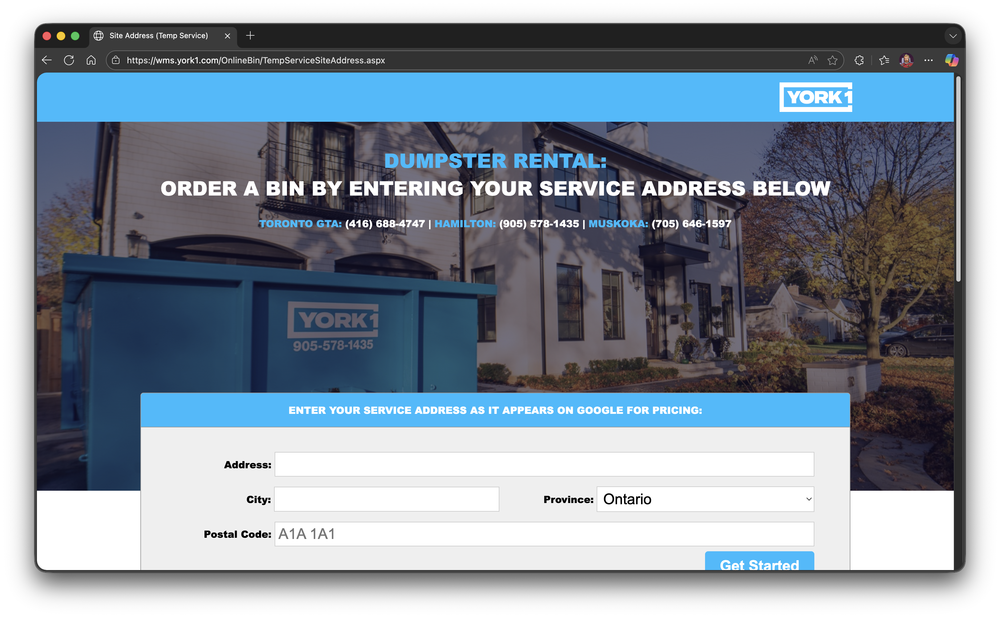

# Client Work Case Studies

This is a repository with some information about client work I have performend, intended to be a companion to my portfolio.

## Projects

### [Dasvandh Network](./Dasvandh-Network/)

A rebuild of the online Sikh giving platform that connects donors with verified Sikh organizations, projects, and fundraisers, replacing a legacy server-rendered site with a modern, mobile-first front end. I was the lead front end developer during my time with Skyrocket Digital.

_Worked on from Spring 2026 to present._

### [Ocean Wise: Whale Health](./Ocean-Wise-Whale-Health/)

A research platform that uses computer vision to detect whales in drone imagery and measure their health, letting researchers review, correct, and verify landmark placements and metrics such as body area index and pregnancy before exporting them for analysis. I was the sole front end developer during my time with Skyrocket Digital.

_Worked on from Fall 2025 to Summer 2026._

### [Ocean Wise: Whale Report Administration](./Ocean-Wise-Whale-Report-Admin/)

An administration application for the Whale Reporting system, allowing Ocean Wise administrators to view, modify (if required), and validate whale sightings.

_Worked on from Fall 2024 to Summer 2025, with ongoing maintenance._

### [Ocean Wise: Whale Report Alert System](./Ocean-Wise-Whale-Report/)

A real time system which everyday users and mariners alike can use to report and be alerted to the presence of whales in shipping lanes with the end goal of reducing fatal ship interactions. Worked on during my time with Skyrocket Digital.

_Worked on from Summer 2024 to Summer 2025, with ongoing maintenance._

### [York 1](./York1/)

A system for industrial and construction clients to to order rentals for waste disposal bins.

_Worked on from Summer 2023 to Summer 2024._

### [Code4rena Platform](./Code4rena-Platform/)

Code4rena (C4) is a competitive audit and bounty platform where security researchers (referred to as Wardens) review, audit, and analyze codebases for security vulnerabilities in exchange for bounties provided by sponsoring projects. I worked on the platform during my time with Stack Five.

_Worked on from Spring 2023 to Summer 2024._

