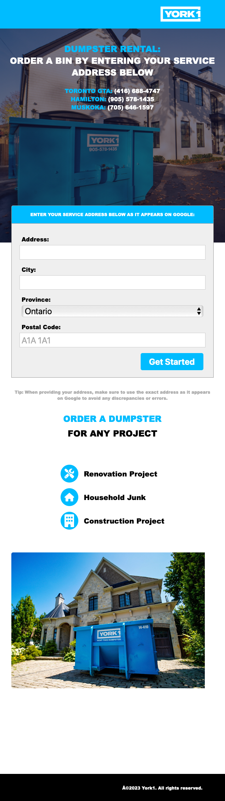
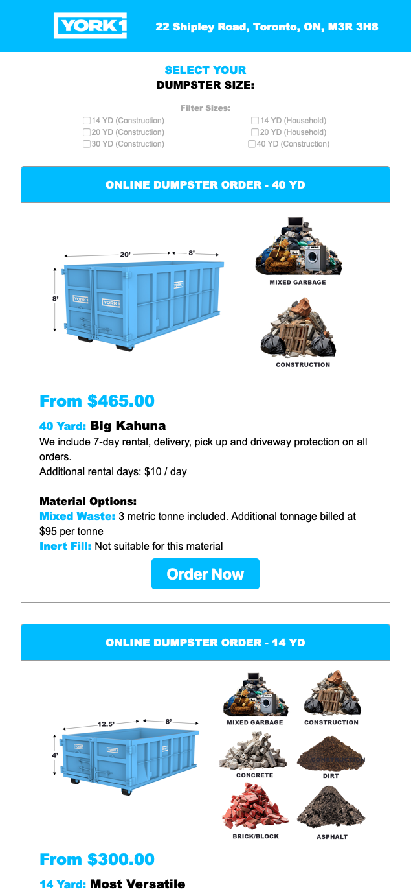
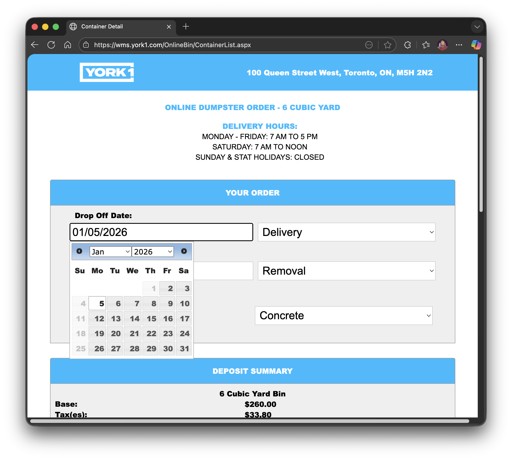
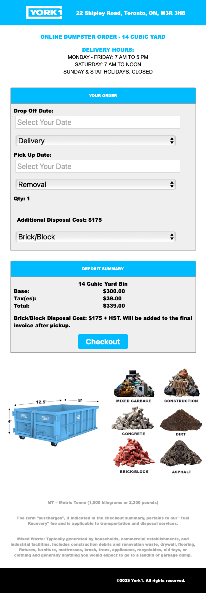
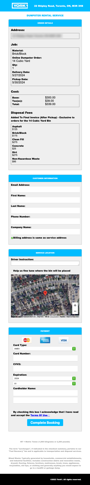

## York1 Dumpster Rental Store

York1 is a major provider of environmental and waste management services. In addition to services such as truck rentals and soil remediation, they also supply dumpster rentals and waste removal to contruction sites in Toronto, Canada, and the surrounding regions.

During my time with [Stack Five](https://stackfive.io) I was the lead developer contracted to re-design the dumpter rental portion of their website. The templates and styles needed to be updated to provide a modern, mobile first design.

[York 1 Dumpster Rental](https://wms.york1.com/OnlineBin/TempServiceSiteAddress.aspx)

### Tech Stack

HTML, SCSS/Sass, JavaScript, JQuery, .NET, [Trux](https://www.truxnow.com)

### Challenges

The system provided a unique challenge of needing to have modern HTML, CSS, and JavaScript in place for an updated, responsive design while at the same time maintaining the legacy .NET and C# code that the platform the client uses outputs. Each page of the flow originally had superfluous structure code with both JavaScript CSS in place, creating a very difficult to read files that needed to be streamlined.

### Screenshots

#### Address Input (Mobile)

The first page of the rental flow, in which a client enters their address. The address entered will determine which waste bins the client is offered for rental, and is limited to Ontario addresses.

#### Dumpster Options (Mobile)

Once a clients address has been verified, they are presented with bin options. This page is created with components generated with HTML5 and SCSS styling, populated by the .NET output from the system.

#### Dropoff/Pickup Options (Desktop)

THe user selects the the dates for the bin to be dropped off and picked up from the site. The calendar component is loaded via JQuery to maintain backward compatibility, with holiday dates and weekends eliminated programatically.

#### Dropoff/Pickup Options (Mobile)

#### Billing

The final page in which a customers order is summarized and payment taken. The client is also offered a change to refine exactly where the bin is placed at their site.

